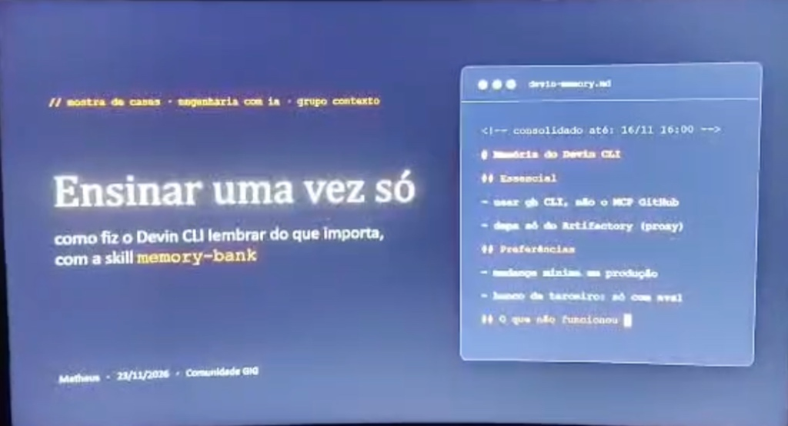

# Slide 01 — Ensinar uma vez só

> **Seção:** Capa

## Imagem do Slide

## Fala Sugerida (Roteiro Melhorado)

Quem usa o Devin CLI no dia a dia já passou por isso: você corrige uma ferramenta, explica uma regra do nosso ambiente e, na sessão seguinte, ele já esqueceu tudo. Hoje eu vou mostrar como eu parei de repetir as mesmas coisas e fiz o agente lembrar do que importa — como essas regras aqui do lado — usando uma skill chamada `memory-bank`.

## Conteúdo na Tela

- **Tag:** `// mostra de cases · engenharia com ia · grupo contexto`
- **Título:** Ensinar uma vez só — como fiz o Devin CLI lembrar do que importa, com a skill `memory-bank`
- **Rodapé:** Matheus · 23/11/2026 · Comunidade GIG
- **Janela (`devin-memory.md`):**
  - `<!-- consolidado até: 16/11 16:00 -->`
  - `# Memória do Devin CLI`
  - `## Essencial`: usar gh CLI, não o MCP GitHub; deps só do Artifactory (proxy)
  - `## Preferências`: mudança mínima em produção; banco de terceiros: só com aval
  - `## O que não funcionou`

## Nota / Roteiro Original

Aquele arquivo é o produto final: o que o agente precisa saber de mim. Vou mostrar como cheguei nele.
