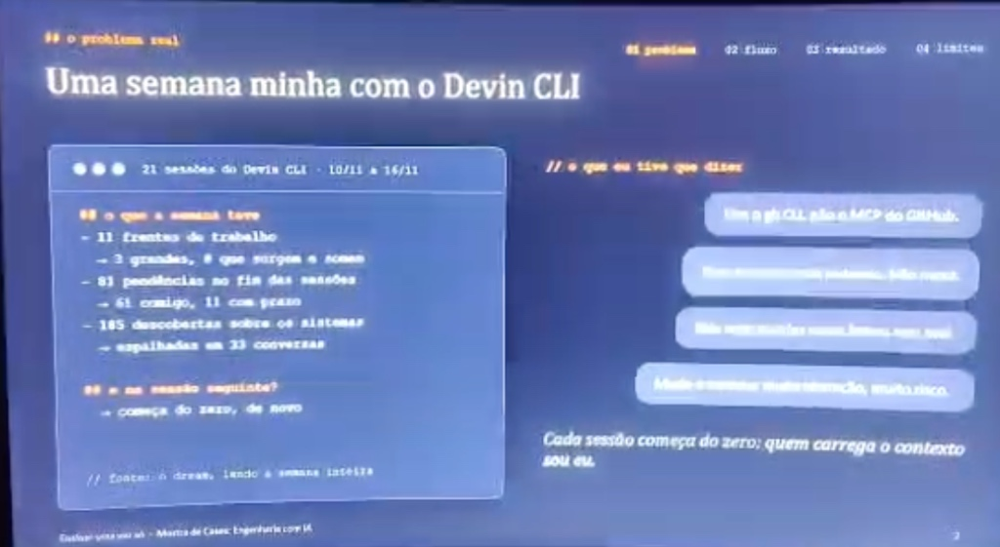

# Slide 02 — Uma semana minha com o Devin CLI

> **Seção:** 01 problema · o problema real

## Imagem do Slide

## Fala Sugerida (Roteiro Melhorado)

Para ter ideia do tamanho dessa dor, eu medi uma semana real de trabalho minha no CLI: foram 21 sessões, 11 frentes diferentes e quase 200 descobertas sobre os nossos sistemas. Só que, na sessão seguinte, tudo isso zera — e quem acaba carregando esse contexto nas costas sou eu.

## Conteúdo na Tela

- **Terminal (`21 sessões do Devin CLI · 10/11 a 16/11`):**
  - **11 frentes de trabalho** (3 grandes, 8 que surgem e somem)
  - **81 pendências no fim das sessões** (61 comigo, 11 com prazo)
  - **185 descobertas sobre os sistemas** (espalhadas em 33 conversas)
  - **E na sessão seguinte?** → começa do zero, de novo
  - `// fonte: o dream, lendo a semana inteira`
- **Balões (`// o que eu tive que dizer`):**
  - Use o gh CLI, não o MCP do GitHub.
  - *(Demais balões com instruções repetidas sobre restrições e contexto)*
- **Destaque:** *Cada sessão começa do zero: quem carrega o contexto sou eu.*

## Nota / Roteiro Original

Uma semana gera muito contexto e a sessão seguinte começa do zero. Quem carrega o contexto sou eu.
