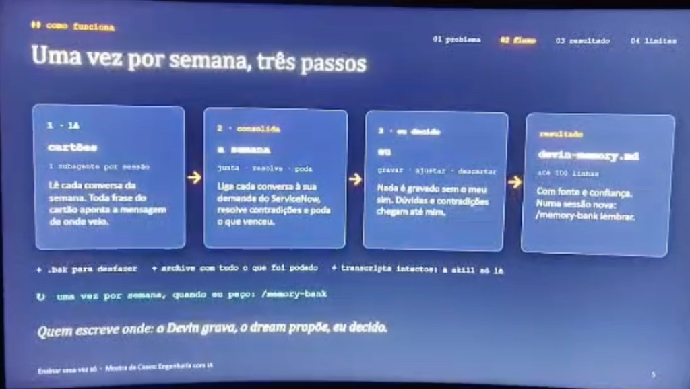

# Slide 05 — Uma vez por semana, três passos

> **Seção:** 02 fluxo · como funciona

## Imagem do Slide

## Fala Sugerida (Roteiro Melhorado)

O fluxo principal roda uma vez por semana, em três etapas. Primeiro, ele lê as conversas da semana usando subagentes e cria cartões onde cada afirmação aponta a mensagem de origem — nada é inventado. Segundo, ele cruza essas conversas com o meu board do ServiceNow, resolve contradições e apaga o que já venceu. Terceiro: ele me mostra tudo e eu decido. Nada entra na memória oficial sem o meu 'sim'.

## Conteúdo na Tela

- **1 · lê (`cartões`):** 1 subagente por sessão. Lê cada conversa da semana. Toda frase do cartão aponta a mensagem de onde veio.
- **2 · consolida (`a semana`):** junta · resolve · poda. Liga cada conversa à sua demanda do ServiceNow, resolve contradições e poda o que venceu.
- **3 · eu decido (`eu`):** gravar · ajustar · descartar. Nada é gravado sem o meu sim. Dúvidas e contradições chegam até mim.
- **Resultado (`devin-memory.md`):** até 100 linhas. Com fonte e confiança. Numa sessão nova: `/memory-bank lembrar`.
- **Notas:** `.bak` para desfazer · `archive` com tudo o que foi podado · `transcripts` intactos: a skill só lê · uma vez por semana, quando eu peço: `/memory-bank`.
- **Destaque:** *Quem escreve onde: o Devin grava, o dream propõe, eu decido.*

## Nota / Roteiro Original

Cada conversa vira um cartão com prova, o dream liga as conversas às demandas oficiais e poda o que venceu, e nada é gravado sem o meu sim.
