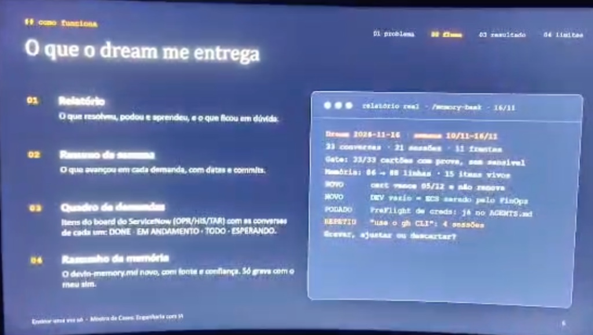

# Slide 06 — O que o dream me entrega

> **Seção:** 02 fluxo · como funciona

## Imagem do Slide

## Fala Sugerida (Roteiro Melhorado)

Quando eu rodo o comando no fim da semana, o terminal não sai alterando arquivo escondido. Ele me entrega um relatório auditável: o que é novidade, o que ele podou porque já foi para a documentação oficial do repo, e o que se repetiu várias vezes. Com isso na tela, eu só respondo se quero gravar, ajustar ou descartar.

## Conteúdo na Tela

- **01 Relatório:** O que resolveu, podou e aprendeu, e o que ficou em dúvida.
- **02 Resumo da semana:** O que avançou em cada demanda, com datas e commits.
- **03 Quadro de demandas:** Itens do board do ServiceNow (OPR/HIS/TAR) com as conversas de cada um: DONE · EM ANDAMENTO · TODO · ESPERANDO.
- **04 Rascunho da memória:** O `devin-memory.md` novo, com fonte e confiança. Só grava com o meu sim.
- **Terminal (`relatório real · /memory-bank · 16/11`):** 33 conversas · 21 sessões · 11 frentes | Gate: 33/33 cartões com prova, sem sensível | Memória: 86 → 88 linhas · 15 itens vivos | NOVO, PODADO, REPETIU | `Gravar, ajustar ou descartar?`

## Nota / Roteiro Original

Recebo relatório, resumo, quadro e rascunho. O terminal mostra o que é novo, o que podou e o que se repetiu, e pergunta se grava.
