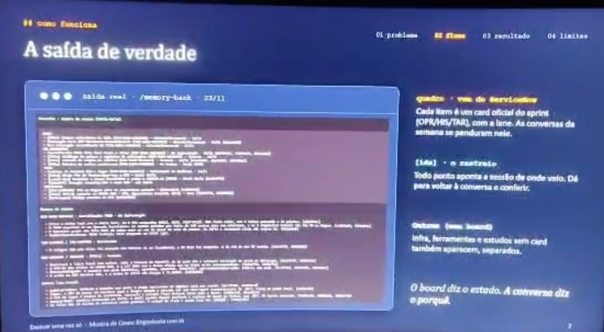
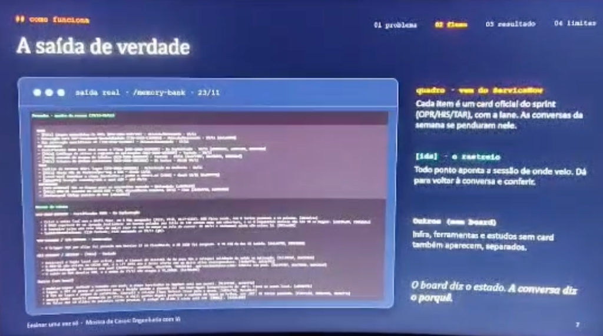

# Slide 07 — A saída de verdade

> **Seção:** 02 fluxo · como funciona

## Imagem do Slide

## Fala Sugerida (Roteiro Melhorado)

E essa aqui é a saída real de uma semana. Em vez de um resumo solto, ele estrutura tudo pendurado nos cards oficiais da sprint do ServiceNow. Cada ponto tem o ID da sessão de onde veio, então eu consigo rastrear o porquê de qualquer decisão. O board me diz o estado da tarefa; a conversa me explica o porquê.

## Conteúdo na Tela

- **Janela (`saída real · /memory-bank · 23/11`):** Print real do quadro e do resumo da semana.
- **Legendas:**
  - **quadro · vem do ServiceNow:** Cada item é um card oficial do sprint (OPR/HIS/TAR), com a lane. As conversas da semana se penduram nele.
  - **`[ids]` · o rastreio:** Todo ponto aponta a sessão de onde veio. Dá para voltar à conversa e conferir.
  - **Outros (sem board):** Infra, ferramentas e estudos sem card também aparecem, separados.
- **Destaque:** *O board diz o estado. A conversa diz o porquê.*

## Nota / Roteiro Original

Cada linha é um card oficial do sprint com as conversas penduradas nele, e cada ponto aponta a sessão de onde veio. O board diz o estado, a conversa diz o porquê.
