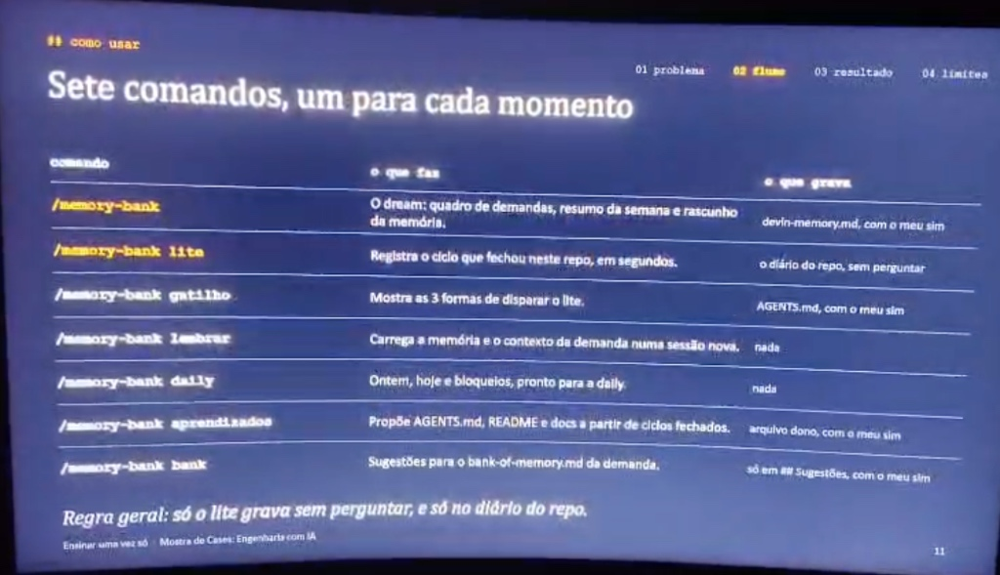
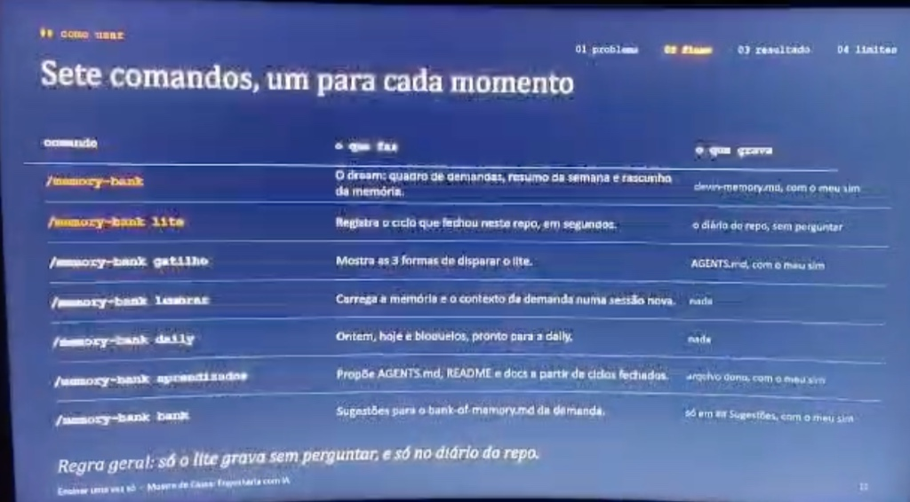

# Slide 11 — Sete comandos, um para cada momento

> **Seção:** 02 fluxo · como usar

## Imagem do Slide

## Fala Sugerida (Roteiro Melhorado)

No dia a dia, a skill tem sete comandos, mas a lógica é simples: existem dois ritmos de captura — o *dream* semanal e o *lite* no fim de cada tarefa — e o restante são comandos de leitura, como gerar o status da *daily* ou puxar contexto para uma sessão nova. E, por segurança, o único que grava sem perguntar é o *lite*, e só no diário local do repositório.

## Conteúdo na Tela

| Comando | O que faz | O que grava |
| :--- | :--- | :--- |
| `/memory-bank` | O dream: quadro de demandas, resumo da semana e rascunho da memória. | `devin-memory.md`, com o meu sim |
| `/memory-bank lite` | Registra o ciclo que fechou neste repo, em segundos. | o diário do repo, sem perguntar |
| `/memory-bank gatilho` | Mostra as 3 formas de disparar o lite. | `AGENTS.md`, com o meu sim |
| `/memory-bank lembrar` | Carrega a memória e o contexto da demanda numa sessão nova. | nada |
| `/memory-bank daily` | Ontem, hoje e bloqueios, pronto para a daily. | nada |
| `/memory-bank aprendizados` | Propõe `AGENTS.md`, `README` e docs a partir de ciclos fechados. | arquivo dono, com o meu sim |
| `/memory-bank bank` | Sugestões para o `bank-of-memory.md` da demanda. | só em `## Sugestões`, com o meu sim |

- **Regra geral:** *só o lite grava sem perguntar, e só no diário do repo.*

## Nota / Roteiro Original

São dois ritmos, o dream semanal e o lite no fim do ciclo. Os outros comandos aproveitam o mesmo material: lembrar, daily, aprendizados e bank. Só o lite grava sem perguntar.
