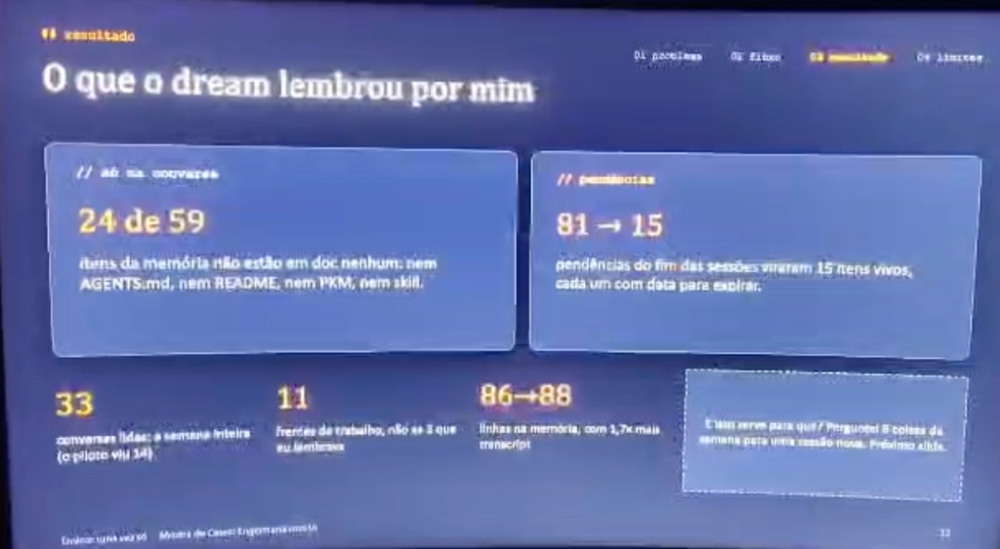

# Slide 13 — O que o dream lembrou por mim

> **Seção:** 03 resultado

## Imagem do Slide

## Fala Sugerida (Roteiro Melhorado)

Na prática, o que ele lembrou que eu teria perdido? Quase metade dos itens consolidados na memória só existia no meio das conversas — não estava em README, nem em doc nenhum. Das 81 pendências soltas no fim das sessões, ele filtrou 15 itens realmente vivos, todos com data de expiração para a memória não virar um cemitério de tarefas.

## Conteúdo na Tela

- **24 de 59 (`// só na conversa`):** itens da memória não estão em doc nenhum: nem `AGENTS.md`, nem `README`, nem PKM, nem skill.
- **81 → 15 (`// pendências`):** pendências do fim das sessões viraram 15 itens vivos, cada um com data para expirar.
- **Rodapé:**
  - **33** conversas lidas (o piloto viu 14)
  - **11** frentes de trabalho, não as 3 que eu lembrava
  - **86 → 88** linhas na memória, com 1,7x mais transcript
- **Caixa pontilhada:** *E isso serve para quê? Perguntei 8 coisas da semana para uma sessão nova. Próximo slide.*

## Nota / Roteiro Original

24 itens só existiam na conversa, e ele achou 11 frentes onde eu lembrava de 3. Serve para quê? Próximo slide.
