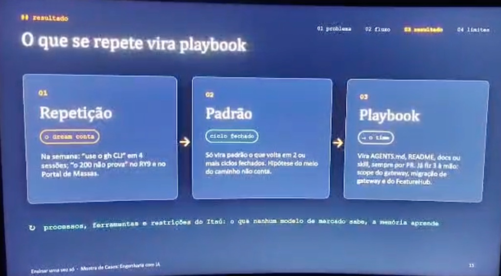

# Slide 15 — O que se repete vira playbook

> **Seção:** 03 resultado

## Imagem do Slide

## Fala Sugerida (Roteiro Melhorado)

E o ganho não morre na minha máquina. Quando uma correção se repete em vários ciclos — como usar o `gh CLI` em vez do MCP do GitHub, ou regras específicas de homologação nossa — ela deixa de ser memória pessoal e vira proposta de PR para o `AGENTS.md` ou para a documentação do time. É assim que a gente ensina para o agente as regras internas do Itaú que nenhum modelo de mercado conhece.

## Conteúdo na Tela

- **01 Repetição (`o dream conta`):** Na semana: "use o gh CLI" em 4 sessões; "o 200 não prova" no RY9 e no Portal de Massas.
- **02 Padrão (`ciclo fechado`):** Só vira padrão o que volta em 2 ou mais ciclos fechados. Hipótese do meio do caminho não conta.
- **03 Playbook (`→ o time`):** Vira `AGENTS.md`, `README`, docs ou skill, sempre por PR. Já fiz 3 à mão: scope do gateway, migração de gateway e do FeatureHub.
- **Destaque:** *processos, ferramentas e restrições do Itaú: o que nenhum modelo de mercado sabe, a memória aprende.*

## Nota / Roteiro Original

Só vira padrão o que voltou em 2 ciclos fechados, e vai para o time por PR. É o que nenhum modelo de mercado sabe sobre o Itaú.
