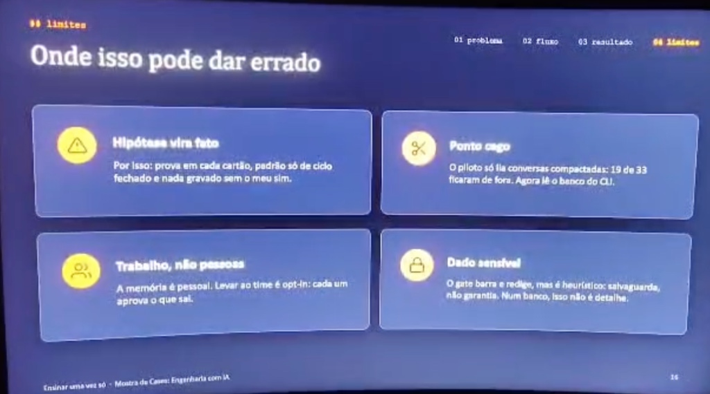

# Slide 16 — Onde isso pode dar errado

> **Seção:** 04 limites

## Imagem do Slide

## Fala Sugerida (Roteiro Melhorado)

Claro que existem riscos, e eu mapeei os quatro principais. O primeiro é o agente transformar uma hipótese errada em fato — que a gente trava exigindo citação da mensagem original e aprovação humana. O segundo era um ponto cego do piloto, que só lia sessões compactadas e já foi corrigido lendo o banco completo do CLI. O terceiro é cultural: essa ferramenta registra o trabalho e o sistema, nunca as pessoas, e compartilhar com o time é sempre *opt-in*. E o quarto, crítico aqui dentro, é dado sensível: o script tem um filtro que mascara tokens e chaves, mas é heurístico — funciona como salvaguarda, não como garantia absoluta.

## Conteúdo na Tela

- **Hipótese vira fato:** Por isso: prova em cada cartão, padrão só de ciclo fechado e nada gravado sem o meu sim.
- **Ponto cego:** O piloto só lia conversas compactadas: 19 de 33 ficaram de fora. Agora lê o banco do CLI.
- **Trabalho, não pessoas:** A memória é pessoal. Levar ao time é opt-in: cada um aprova o que sai.
- **Dado sensível:** O gate barra e redige, mas é heurístico: salvaguarda, não garantia. Num banco, isso não é detalhe.

## Nota / Roteiro Original

Cada risco tem uma mitigação. Dê ênfase ao cadeado: o filtro de sensível é uma salvaguarda, não uma garantia.
