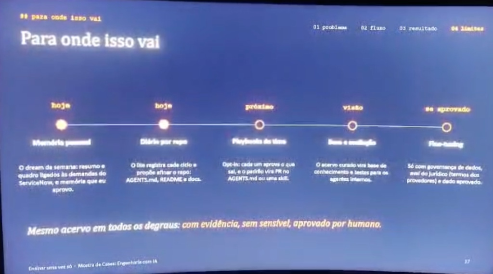

# Slide 17 — Para onde isso vai

> **Seção:** 04 limites · para onde isso vai

## Imagem do Slide

## Fala Sugerida (Roteiro Melhorado)

Olhando para frente, os dois primeiros degraus — memória pessoal e diário por repositório — já estão rodando hoje. O próximo passo natural é escalar os playbooks do time via PR. Mais adiante, esse acervo curado e sem dados sensíveis pode servir como base de avaliação para os nossos agentes internos e, se um dia fizer sentido e tiver aval jurídico e de governança, até para *fine-tuning*.

## Conteúdo na Tela

1. **hoje — Memória pessoal:** O dream da semana: resumo e quadro ligados às demandas do ServiceNow, e memória que eu aprovo.
2. **hoje — Diário por repo:** O lite registra cada ciclo e propõe afinar o repo: `AGENTS.md`, `README` e docs.
3. **próximo — Playbooks do time:** Opt-in: cada um aprova o que sai, e o padrão vira PR no `AGENTS.md` ou uma skill.
4. **visão — Base e avaliação:** O acervo curado vira base de conhecimento e testes para os agentes internos.
5. **se aprovado — Fine-tuning:** Só com governança de dados, aval do jurídico (termos dos provedores) e dado aprovado.
- **Destaque:** *Mesmo acervo em todos os degraus: com evidência, sem sensível, aprovado por humano.*

## Nota / Roteiro Original

A memória pessoal e o diário por repo já existem. Depois vêm playbooks, base de avaliação e, se aprovado, fine-tuning, sempre com o mesmo acervo curado.
